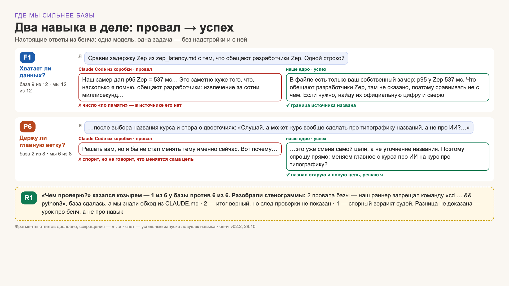
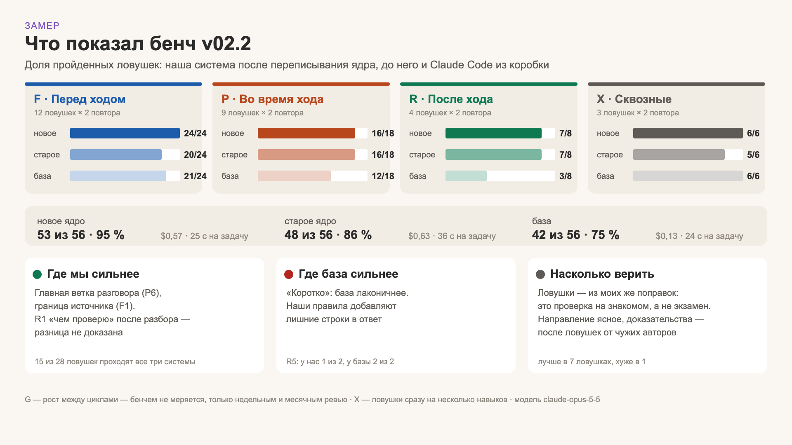
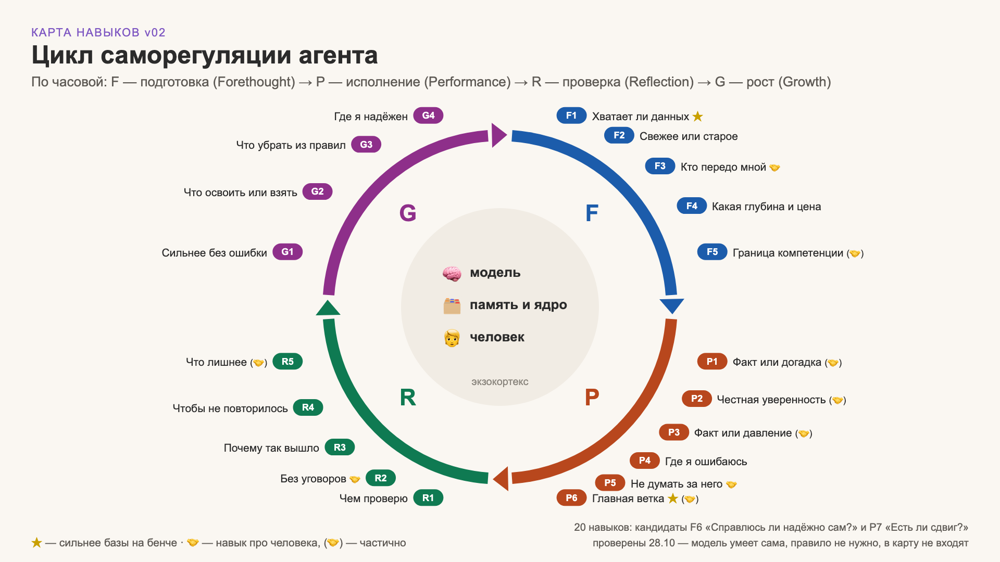

# metacog-bench

**Does your CLAUDE.md actually change what your agent does?**
Your agent already does most of what your rules ask. Find the lines that matter.

A lab notebook from six months of running a personal assistant on Claude Code and measuring it against Claude Code out of the box: a map of 20 self-check skills, two rules worth pasting today, a no-code way to test your own rules in an evening, and the method we used to measure honestly.

> 知之为知之，不知为不知，是知也 — *"To know what you know and to admit what you don't — that is knowing."* (Analects 2.17)

**Status: v0.1.** Skill map, rules, findings and results are here. The trap runner is a research artifact (Russian prompts, macOS) and is being ported — see [traps/](traps/).

## Words used here

| Word | Meaning |
|---|---|
| **vanilla** | Claude Code out of the box: same model, no CLAUDE.md, memory or skills |
| **core** | our setup: CLAUDE.md + imported rules + memory + skills |
| **trap** | a short scenario where an agent should stop and ask itself one question; each has a pass criterion |
| **oracle** | a pass/fail check done by code (count, regex, file on disk); **judges** are LLMs with a rubric |
| **fired** | what you can see in the answer when the skill worked |

## Three findings

1. **A rule in a file is not a rule in context.** `CLAUDE.md` loads automatically. A file it merely tells the agent to "read" was read in 25–50 % of runs in our small pilot (N = 2 per variant). With `@import` it was in context every time — and the runs got cheaper, because the agent stopped spending turns on reading. → [details](docs/findings.md#1-a-rule-in-a-file-is-not-a-rule-in-context)
2. **Test vanilla first, then write the rule.** 15 of 28 traps were passed by vanilla and both our versions alike. We forecast vanilla would pass ~8 of 16 traps — it passed 11. Two candidate skills we tested were dropped: vanilla did them on its own at a fifth of the cost. → [details](docs/findings.md#2-test-vanilla-first-then-write-the-rule)
3. **Our setup won on two skills: source boundary (F1) and main thread (P6).** These were measured with the whole core, not the rules alone — the "vanilla + these two rules" run is pending. → [details](docs/findings.md#3-where-our-setup-won)


*Real answers from the bench: vanilla (left) vs our core (right). Slides are in Russian for now; captions in [docs/images.md](docs/images.md).*

## Two rules to paste today

**F1 · Source boundary**
```text
When asked what a named source says and the source doesn't say it, answer
"the source doesn't say this" and offer to check. Don't fill in a number or a
quote from memory, not even with a caveat.
```

**P6 · Main thread**
```text
Hold the main goal of the session. Follow side topics fully. When a side topic
is closed ("thanks", "got it", moving on), add one line about what is still
waiting for a decision in the main thread. If the person changes the goal
itself, name both and ask: "My understanding of the task was X; you suggest Y
— shall we update?"
```

More, with when-to-use notes: [snippets/](snippets/). Put them into `CLAUDE.md` directly or via `@import` — not behind "please read X.md" (finding 1).

## Check your own rules in one evening, no code

1. Take the last three corrections you gave your agent. Turn each into a task with a clear success criterion.
2. Run each task twice:
   ```bash
   claude -p "$TASK"               # with your CLAUDE.md, memory, skills
   claude -p --safe-mode "$TASK"   # vanilla
   ```
3. Compare the answers yourself, or blind them and ask a judge from a different model family.

If vanilla passes, the rule behind that correction is probably dead weight.

## How do you know it's working?

> *"Just out of curiosity, count how many errors you caught in this session and how many I pointed out. Isn't that the measure of success?"*
> — the author to his assistant, 27.10.2026 (translated from Russian)

We measure on three levels: a linter for form (L0), traps for skills (L1), and the human's corrections per week (L2 — the one that matters). Method, limits and what we got wrong: [docs/method.md](docs/method.md).

## Results so far

| System | Traps passed | Cost / task |
|---|---|---|
| Our core | 53 / 56 · 95 % | $0.57 |
| Our core before refactor | 48 / 56 · 86 % | $0.63 |
| Vanilla Claude Code | 42 / 56 · 75 % | $0.13 |

28 traps × 2 repeats, one model (claude-opus-5-5), 28.10.2026. **Read this as validation, not a test:** most traps were written from our own past failures, some rules were rewritten after the run, and three F1 traps are paraphrases of one scene. Per-trap data: [results/2026-10-28_v02.2/](results/2026-10-28_v02.2/).



## The skill map

20 skills as questions an agent asks itself at four moments: **F** before acting → **P** while working → **R** before saying "done" → **G** between cycles. The first three phases follow Zimmerman's self-regulation cycle; G is our addition.

**Plain-language manual: [SKILLS.md](SKILLS.md)**



## What's inside

```
metacog-bench/
├── README.md
├── SKILLS.md          human manual: 20 skills, one table each phase
├── snippets/          rules to paste: F1, P6, R1
├── traps/             trap index; runner port in progress
├── results/<run>/     per-trap results; yours welcome
├── docs/
│   ├── findings.md    the three findings with evidence
│   ├── method.md      sealed forecast, code + judges, train/validate/test, limits
│   ├── sources.md     research anchors
│   └── images.md      slides with captions
├── schemas/           manifest.schema.json for result submissions
├── CONTRIBUTING.md
└── LICENSE
```

## Contributing

Every contribution adds a new folder and edits no shared file: a run goes to `results/<date>_<github-user>_<label>/`, a trap from a real failure of your agent goes to `traps/community/<id>/`. Details: [CONTRIBUTING.md](CONTRIBUTING.md).

## Where this came from

Talks at Creative Workshop · AI Jam, 30.09 and 29.10.2026. A paper may follow once the bench has outside traps, a second model and a vanilla + rules arm.

License: MIT for code, CC BY 4.0 for text and images.
