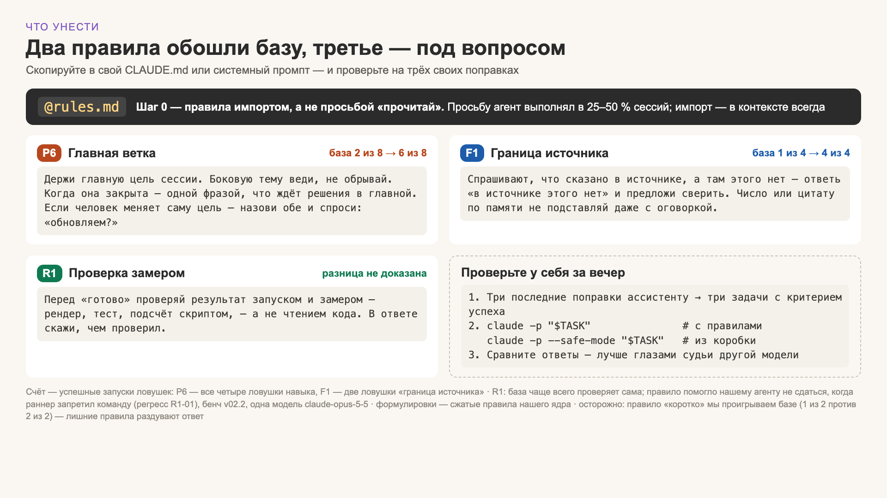

# Findings

All numbers: bench v02.2, 28.10.2026, claude-opus-5-5 in Claude Code, 28 traps × 2 repeats unless stated. Limits of these numbers: [method.md](method.md#limits).

## 1. A rule in a file is not a rule in context

`CLAUDE.md` is loaded into every session automatically. Anything else — a manual, a style guide — gets into context only if the agent decides to read it. Claude Code's docs call memory files "context, not enforced configuration".

- When `CLAUDE.md` only said "read the manual", the agent read it in **25–50 % of runs** (pilot, N = 2 per variant).
- With the manual pulled in by `@import`: in context **every** time; on traps where the manual matters, 10 of 10 runs vs 6 of 10.
- It was also **cheaper**: $0.24 vs $0.28 per single-turn task, $0.43 vs $0.74 per multi-turn task — the agent stopped spending turns on reading files.

**Do this:** `@import` what must always apply; keep on-demand procedures as skills; never rely on "please read X".

## 2. Test vanilla first, then write the rule

- 15 of 28 traps were passed by all three systems, vanilla included.
- Our sealed forecast: vanilla ~8 of 16 traps. Fact: 11 of 16. We underestimated it twice.
- Two candidate skills ("can I do this reliably myself?" and "has the situation shifted — change approach?") were tested with 5 traps: vanilla did them on its own at about a fifth of our cost. They were not added.
- Our core costs ~4× vanilla per task ($0.57 vs $0.13). Every rule has to pay for itself.

**Do this:** before writing a rule from a correction, turn the correction into a task and run it on vanilla (`claude -p --safe-mode`). If vanilla passes, skip the rule.

## 3. Where our setup won

| Skill | Core | Vanilla | Caveat |
|---|---|---|---|
| F1 · source boundary | 12/12 | 9/12 | vanilla's 3 misses come from one scene written three ways |
| P6 · main thread | 6/8 | 2/8 | rule rewritten after the first run of these traps |
| R1 · verify by measuring | 6/6 | 1/6 | **not proven**: our runner blocked a command vanilla tried; two vanilla answers were right without a visible check |
| R5 · what is superfluous | 1/2 | 2/2 | vanilla better: our rules add lines |

These compare the **whole core** (rules + memory + skills) with vanilla. The run "vanilla + only the F1 and P6 rules" is not done yet, so the effect is not yet attributed to the rules alone.

**Long sessions.** In two real multi-hour sessions replayed by a user simulator (3 repeats each), vanilla came last in 10 of 12 blind judge verdicts; our core cost ~1.8× vanilla.

