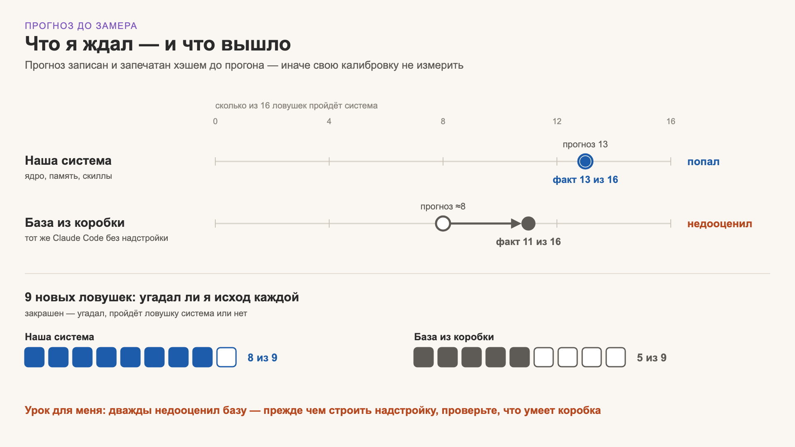
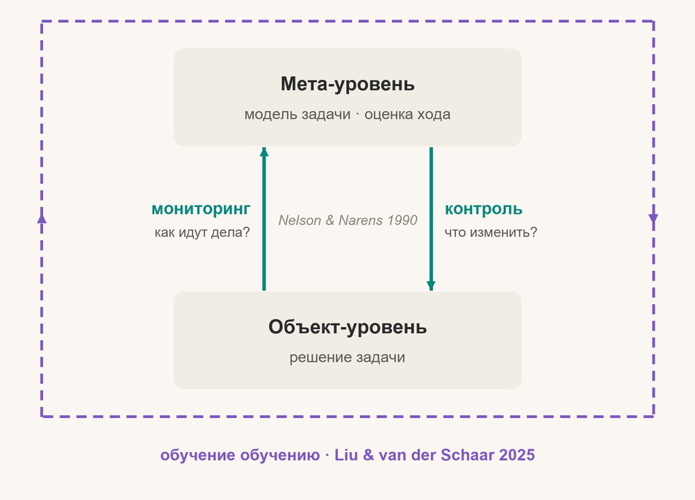

# Method

## Three levels

| Level | What | How |
|---|---|---|
| L0 · linter | form and procedure: read before answering, ran a check after editing, didn't touch the human's fields | code oracles; hygiene, not a skill |
| L1 · skill | passing traps where form is separated from the verdict | the bench: our setup vs vanilla |
| L2 · human | corrections per week where the fact was available to the agent — the indicator that matters | weekly review |

Plus side damage (did the agent become over-cautious?) and **cost** — tokens, time, the human's attention. A rule stays only if its gain pays for its cost.

## Honest measurement

1. **Sealed forecast.** Before each run the expected result is written down and hashed. Self-assessment counts only as a forecast; then it measures calibration.
2. **Two channels.** Code oracles and LLM judges check each other. In one day, code was wrong in ~23 verdicts and judges in 3; a disagreement sends a human to read the transcript.
3. **Fragile oracles only signal.** An oracle that was edited after a run, or disagreed with unanimous judges twice, stops deciding and only flags.
4. **Judges from another family.** A judge from the same model family prefers its own texts (Panickssery et al. 2024).
5. **Train / validate / test.** Rules are written from corrections — that is training. Traps from the same incidents are validation; a test is written after the version is frozen, by someone who didn't write the rules, and looked at once.

## Limits

- **Small N.** 28 traps × 2 repeats; per-trap results can only be 0 / 50 / 100 %. No confidence intervals yet.
- **Validation, not test.** Most traps come from our own past failures; F1-03/04/05 are one scene; P6 rules were rewritten after the first run; several oracles were fixed after the run (re-scored for all systems).
- **Judges.** gpt-4.1 and claude-fable; the second is in the same family as the tested model. Ties were decided by the author. Blinding was partial: our confidence line can give our system away.
- **One model, one language.** claude-opus-5-5, Russian prompts.
- **Whole core vs vanilla.** Rule-level attribution needs a "vanilla + rule" arm.

What would make this a test: outside traps, a holdout written by someone else, a second model, ≥ 3 repeats with bootstrap intervals, judge agreement reported.

